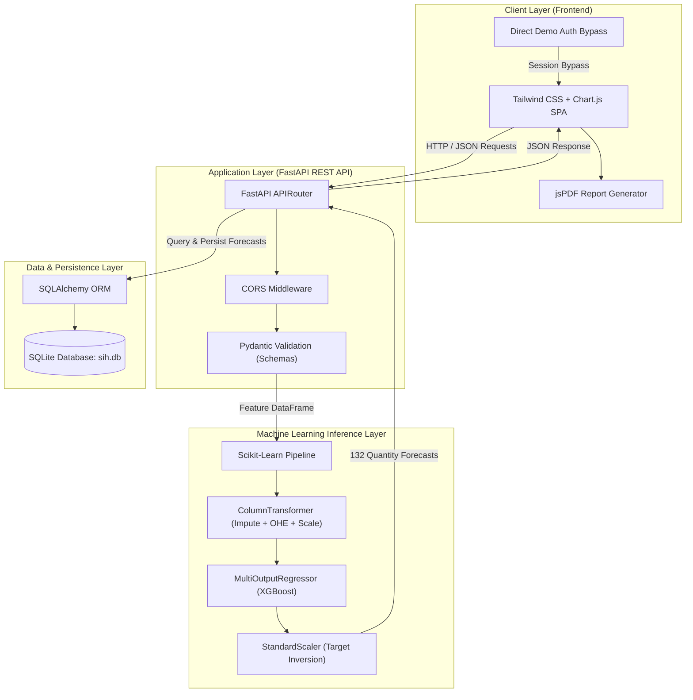
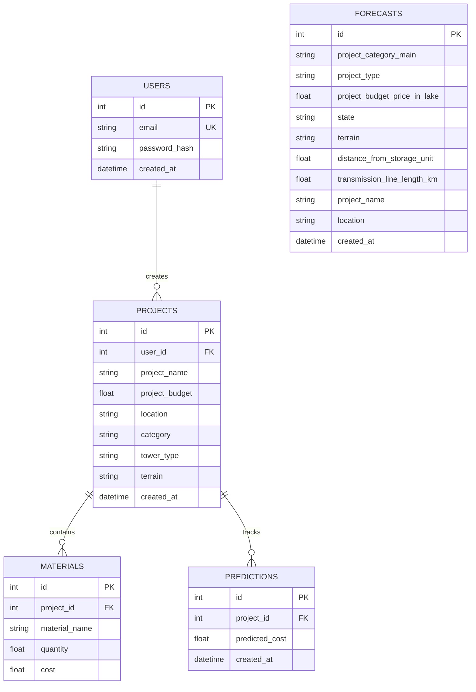

# ⚡ POWERGRID Material Demand Forecasting & Planning System

[](https://www.python.org/)
[](https://fastapi.tiangolo.com/)
[](https://scikit-learn.org/)
[](https://xgboost.readthedocs.io/)
[](https://tailwindcss.com/)
[](https://www.sqlite.org/)
[](https://www.sih.gov.in/)

An end-to-end, AI/ML-driven supply chain and material demand forecasting system developed for **Smart India Hackathon (SIH)** to optimize inventory, procurement schedules, and material planning for **POWERGRID Corporation of India Limited** transmission infrastructure projects.

---

## 📋 Table of Contents

- [Executive Summary](#-executive-summary)
- [System Architecture](#-system-architecture)
- [Key Features](#-key-features)
- [Machine Learning Pipeline](#-machine-learning-pipeline)
  - [Model Specifications](#model-specifications)
  - [Input Features & Preprocessing](#input-features--preprocessing)
  - [Target Quantities (132 Output Classes)](#target-quantities-132-output-classes)
- [Database & Data Management](#-database--data-management)
  - [Entity-Relationship Diagram](#entity-relationship-diagram)
  - [ORM Models & Schema Definitions](#orm-models--schema-definitions)
- [REST API Reference](#-rest-api-reference)
  - [Core Endpoints](#core-endpoints)
  - [Sample Prediction Request & Response](#sample-prediction-request--response)
- [Frontend Architecture](#-frontend-architecture)
- [Installation & Local Setup](#-installation--local-setup)
  - [Prerequisites](#prerequisites)
  - [Quickstart (One Command)](#option-a-quickstart-recommended)
  - [Manual Execution](#option-b-manual-setup)
- [Project Directory Structure](#-project-directory-structure)

---

## 📌 Executive Summary

Constructing high-voltage (HVAC/HVDC) transmission lines and substations spans diverse geographical terrains, varying project durations, and intricate procurement constraints. Inaccurate material forecasting leads to severe inventory bottlenecks, capital lock-up, supply chain delays, and project cost overruns.

This application provides an automated, data-driven material estimation engine that predicts the exact bill of quantities for **132 distinct materials, equipment, and structural components** based on core civil and electrical parameters, offering procurement planners real-time cost visibility and phased requisition planning.

---

## 🏗️ System Architecture

The solution adopts a decoupled, micro-tier architecture comprising a client presentation layer, a high-throughput asynchronous REST API, a multi-output machine learning inference engine, and a transactional relational data layer:



---

## 🚀 Key Features

* **Instant Multi-Output ML Forecasting**: Accurately computes quantities for 132 unique items within milliseconds using trained gradient-boosted decision trees.
* **Granular Cost Breakdown & Budget Validation**: Automatically calculates total material cost, tax adjustments (GST), and flags budget overruns against estimated project capital.
* **Interactive Data Visualizations**: Real-time expenditure bar charts, material category distribution donuts, and historical trend monitoring powered by Chart.js.
* **Executive PDF Export**: Automated single-click generation of professional procurement reports and Material Requisitions via `jsPDF`.
* **Zero-Friction Evaluation (Demo Access)**: Dedicated direct-entry authentication bypass designed for reviewers and hackathon evaluators without mandatory email confirmation.
* **Persistent Scenario Auditing**: Automatically logs forecast inputs, project parameters, timestamps, and predicted BOMs to SQLite for traceability and compliance.

---

## 🧠 Machine Learning Pipeline

### Model Specifications

The predictive core is built with a decoupled pipeline serialized in `Balanced_Material_Model.pkl` (53 MB) and scaled via `Balanced_YScaler.pkl`:

* **Estimator**: `sklearn.multioutput.MultiOutputRegressor`
* **Base Learner**: `xgboost.XGBRegressor`
  * `learning_rate`: `0.05`
  * `max_depth`: `9`
  * `n_estimators`: `80`
  * `colsample_bytree`: `0.85`
  * `booster`: `gbtree`
* **Target Transformer**: `StandardScaler` fitted on multidimensional target tensors to balance loss across widely differing units (from metric tons of steel to fractional kilometers of optical ground wire).

### Input Features & Preprocessing

The preprocessing stage leverages a `ColumnTransformer` handling mixed tabular data:

| Feature Name | Type | Pipeline Transformation | Description |
|---|---|---|---|
| `project_budget_price_in_lake` | Numerical | `SimpleImputer(mean)` + `StandardScaler` | Total project budget in Lakhs INR |
| `transmission_line_length_km` | Numerical | `SimpleImputer(mean)` + `StandardScaler` | Total length of transmission corridor (km) |
| `Distance_from_Storage_unit` | Numerical | `SimpleImputer(mean)` + `StandardScaler` | Logistics haul distance from regional central depot (km) |
| `project_category_main` | Categorical | `SimpleImputer(most_frequent)` + `OneHotEncoder` | Domain classification (e.g., Transmission, Substation) |
| `project_type` | Categorical | `SimpleImputer(most_frequent)` + `OneHotEncoder` | Voltage rating (400 kV, 765 kV, ±800 kV HVDC, etc.) |
| `state` | Categorical | `SimpleImputer(most_frequent)` + `OneHotEncoder` | State/Union Territory for geographical terrain factors |
| `terrain` | Categorical | `SimpleImputer(most_frequent)` + `OneHotEncoder` | Topography (Plain, Hilly, Desert, Coastal, Forest) |

### Target Quantities (132 Output Classes)

The model predicts 132 equipment and material outputs grouped into foundational domains:

1. **Foundation & Civil**: Cement bags, ready-mix concrete ($m^3$), coarse aggregate, washed sand, backfill soil, excavated soil, gravel.
2. **Structural Steel & Towers**: Galvanized tower steel (kg), reinforcement TMT bars, structural angles, tower legs, body members, extension pieces, pack plates.
3. **High-Voltage Electrical Equipment**: Current Transformers (CT), Potential Transformers (PT), gas-insulated/air-insulated circuit breakers, isolators, thyristor valves, converter transformers, smoothing reactors, harmonic filters.
4. **Conductors & Telecommunication**: ACSR/HTLS conductor (km), optical ground wire (OPGW), continuous earth wire, DC transmission cables, underground control cables, aluminum busbars.
5. **Hardware & Line Accessories**: Suspension and tension insulator disc strings, vibration dampers, spacers, arcing horns, hardware clamps, hot-dip galvanized bolts and nuts, spring washers.
6. **Consumables & Logistics**: Transformer cooling oil, formwork oil, anti-corrosive paint, industrial greases, backup diesel, statutory environmental clearance charges.

---

## 🗄️ Database & Data Management

Data persistence is managed through **SQLAlchemy ORM** backed by an ACID-compliant **SQLite** database (`sih.db`), pre-seeded with project schemas.

### Entity-Relationship Diagram



### ORM Models & Schema Definitions

* **`User`**: Handles user authentication credentials with SHA-256 hashed passwords and creation metadata.
* **`Project`**: Encapsulates project instances with budget constraints, line configurations, and geographical markers.
* **`Material`**: Normalized catalog entries assigned to specific projects with actual quantities and costs.
* **`Forecast`**: Immutable records capturing snapshot inputs and parameter states at prediction time.
* **`Prediction`**: Cost analysis forecasts tied to individual project records.

---

## 📡 REST API Reference

The backend exposes fully documented RESTful APIs with interactive Swagger/OpenAPI documentation accessible at `/docs`.

### Core Endpoints

| Method | Endpoint | Description | Auth Required |
|---|---|---|---|
| `GET` | `/` | API status and health check | No |
| `POST` | `/forecast/predict` | Computes 132 material predictions without persisting | No |
| `POST` | `/forecast/save` | Computes predictions and stores forecast entry in SQLite | No |
| `GET` | `/projects/user/{user_id}` | Retrieves all projects associated with a user ID | No |
| `POST` | `/projects/create` | Registers a new transmission project profile | No |
| `GET` | `/materials/project/{id}` | Retrieves material catalog records for a project | No |
| `POST` | `/materials/create` | Manually records a material entry | No |
| `POST` | `/auth/register` | Registers a new user account | No |
| `POST` | `/auth/login` | Authenticates email & password | No |

### Sample Prediction Request & Response

#### Endpoint: `POST /forecast/predict`

**Request Body (`application/json`):**
```json
{
  "project_category_main": "Transmission",
  "project_type": "400 kV",
  "project_budget_price_in_lake": 750.0,
  "state": "Maharashtra",
  "terrain": "Plain",
  "Distance_from_Storage_unit": 45.0,
  "transmission_line_length_km": 120.0,
  "location": "Nagpur",
  "project_name": "Nagpur-Wardha 400kV Corridor"
}
```

**Response Body (`200 OK`):**
```json
[
  {
    "material_name": "tower_steel_kg (kg)",
    "predicted_value": 4341554.0
  },
  {
    "material_name": "conductor_km (km)",
    "predicted_value": 727.14
  },
  {
    "material_name": "cement_bags (bags)",
    "predicted_value": 17077.45
  },
  {
    "material_name": "insulator_discs_units",
    "predicted_value": 6736.92
  },
  {
    "material_name": "CT_units",
    "predicted_value": 53.49
  },
  {
    "material_name": "PT_units",
    "predicted_value": 47.07
  }
]
```

---

## 🎨 Frontend Architecture

The user interface (`SIH_Powergrid/frontend/index.html`) is structured as a zero-dependency, high-performance Single Page Application:

* **Styling Framework**: Tailwind CSS via runtime CDN with a custom POWERGRID theme palette (`jungle-green: #064E3B`, `pop-pink: #F472B6`, `lime-accent: #D9F99D`).
* **Visualization Layer**: Chart.js integration providing animated, responsive charts for:
  * Top Material Cost Distribution (Horizontal Bar Chart)
  * Foundation vs. Electrical vs. Steel Capex Split (Doughnut Chart)
  * Historical Material Consumption Trajectory
* **Client-Side Export**: `jsPDF` for generating printable, branded procurement summaries directly from the browser DOM.
* **Authentication Layer**: Dual-mode auth supporting Firebase authentication alongside a zero-friction **Direct Demo Access** mechanism for instant evaluators.

---

## ⚙️ Installation & Local Setup

### Prerequisites

* **Operating System**: Linux (Ubuntu 20.04+ recommended), macOS, or Windows WSL2
* **Python**: Version `3.10` or higher
* **Package Manager**: `pip`

---

### Option A: Quickstart (Recommended)

Run the included automated launcher from the repository root:

```bash
# Clone the repository
git clone https://github.com/MilindLate/SIH-R.git
cd SIH-R

# Grant execution rights and run
chmod +x start.sh
./start.sh
```

`start.sh` automatically checks dependencies, boots the FastAPI server on port `8000`, and launches the static frontend server on port `3000`:
* 🌐 **Web Dashboard**: [http://127.0.0.1:3000/index.html](http://127.0.0.1:3000/index.html)
* ⚡ **FastAPI Root**: [http://127.0.0.1:8000](http://127.0.0.1:8000)
* 📖 **Swagger API Docs**: [http://127.0.0.1:8000/docs](http://127.0.0.1:8000/docs)

---

### Option B: Manual Setup

#### 1. Setup Backend
```bash
cd SIH-R/SIH_Powergrid/backend

# Install dependencies
pip install -r requirements.txt

# Start Uvicorn ASGI server
python3 -m uvicorn app:app --host 127.0.0.1 --port 8000 --reload
```

#### 2. Setup Frontend
In a separate terminal window:
```bash
cd SIH-R/SIH_Powergrid/frontend

# Serve static web assets
python3 -m http.server 3000
```
Open your browser and navigate to:
👉 **[http://127.0.0.1:3000/index.html](http://127.0.0.1:3000/index.html)**

Click **🚀 Demo Login (Direct Entry)** to immediately access the dashboard without registration.

---

## 📁 Project Directory Structure

```text
SIH-R/
├── README.md                      # Comprehensive system documentation
├── start.sh                       # Quickstart orchestration script
├── .gitignore                     # Git ignore rules (pycache, envs, IDEs)
└── SIH_Powergrid/
    ├── backend/
    │   ├── app.py                 # FastAPI application root & middleware
    │   ├── database.py            # SQLite engine & sessionmaker
    │   ├── models.py              # SQLAlchemy ORM database models
    │   ├── schemas.py             # Pydantic v2 validation contracts
    │   ├── ml_engine.py           # ML prediction evaluation logic
    │   ├── material_index_map.py  # 132-item target index mapping dictionary
    │   ├── Balanced_Material_Model.pkl # MultiOutput XGBoost ML model (53 MB)
    │   ├── Balanced_YScaler.pkl   # Fitted target StandardScaler
    │   ├── requirements.txt       # Production dependencies
    │   ├── sih.db                 # Seeded SQLite database
    │   └── routes/
    │       ├── __init__.py        # Package initializer
    │       ├── auth_routes.py     # User registration and SHA-256 login
    │       ├── forecast.py        # ML inference & forecast persistence
    │       ├── material_routes.py # Material catalog CRUD
    │       ├── prediction_routes.py # Prediction history endpoints
    │       └── project_routes.py  # Project creation & user projects
    └── frontend/
        ├── index.html             # Production dashboard UI (Tailwind + Chart.js)
        ├── index_Gemini_changes.html # Enhanced dashboard iteration
        └── index_old.html         # Baseline UI archive
```

---

## 📜 License & Acknowledgements

Developed for the **Smart India Hackathon (SIH)**. Built in collaboration with open-source technologies: **FastAPI**, **scikit-learn**, **XGBoost**, **Tailwind CSS**, and **Chart.js**.
